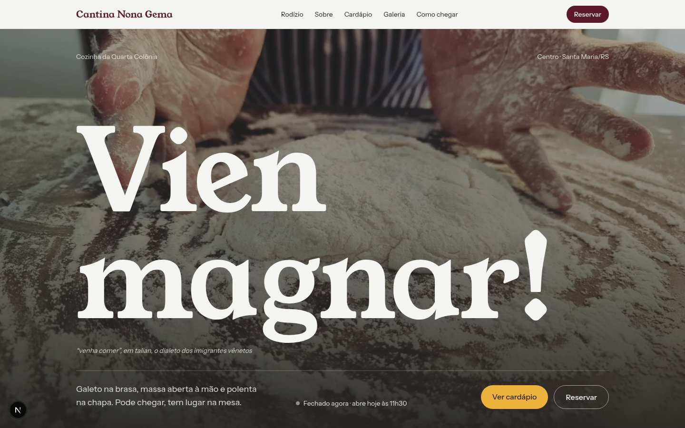
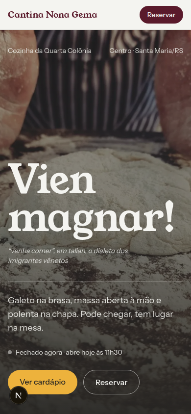
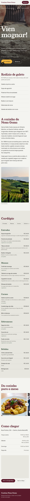
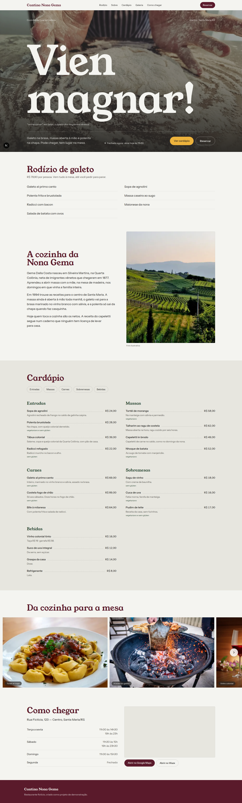
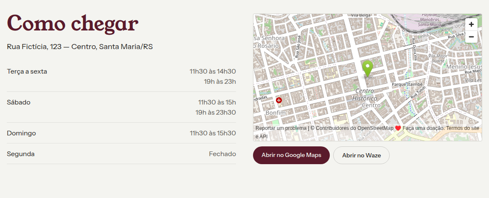
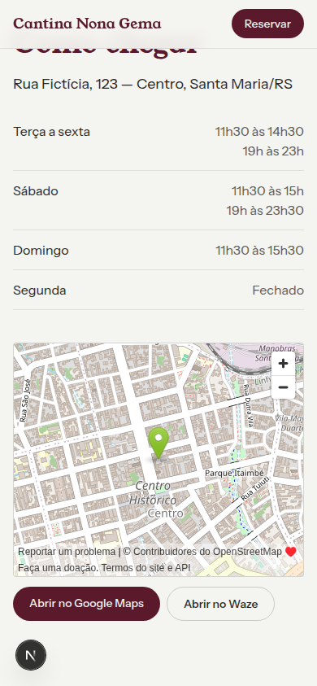

# Cantina Nona Gema

Site de um restaurante **fictício** de cozinha da Quarta Colônia, em Santa Maria/RS.
É um projeto de demonstração, feito para portfólio.

<p>
  
  &nbsp;
  
</p>

## O que tem no site

- **Capa** com o selo "Aberto agora / Fechado agora", calculado a partir dos horários
- **Rodízio de galeto** e **cardápio** por categoria, com marcações de vegetariano e sem glúten
- **A cozinha da Nona Gema**, a história da casa
- **Galeria** de fotos em faixa, com setas no desktop e arraste no celular
- **Como chegar**, com horários, mapa (OpenStreetMap) e botões para o Google Maps e o Waze
- Botão **Reservar** que abre o WhatsApp

Todo o conteúdo (cardápio, preços, horários, WhatsApp, endereço) fica num arquivo só:
`src/data/restaurante.ts`. Para trocar um prato ou um horário, basta editar esse arquivo.

## Feito com

- [Next.js](https://nextjs.org) 16, React 19 e TypeScript
- [Tailwind CSS](https://tailwindcss.com) 4
- Fontes Young Serif e Instrument Sans
- Fotos do [Pexels](https://www.pexels.com), com os créditos em `src/fotos/CREDITOS.md`

Cuidados de acabamento:

- Pensado primeiro para o celular: respeita o notch (safe area) e corrige a altura da tela
- Animações curtas, que desligam quando o sistema pede menos movimento
- Testado com dados extremos (nomes longos, listas vazias, turno que passa da meia-noite)

## Rodar na sua máquina

Precisa do Node 20 ou mais novo.

```bash
npm install
npm run dev
```

Depois, abra http://localhost:3000.

## Prints

<details>
<summary>Página inteira no celular</summary>


</details>

<details>
<summary>Página inteira no desktop</summary>


</details>

<details>
<summary>Como chegar (com o mapa)</summary>



</details>

---

Desenvolvido por Lorenzo.
